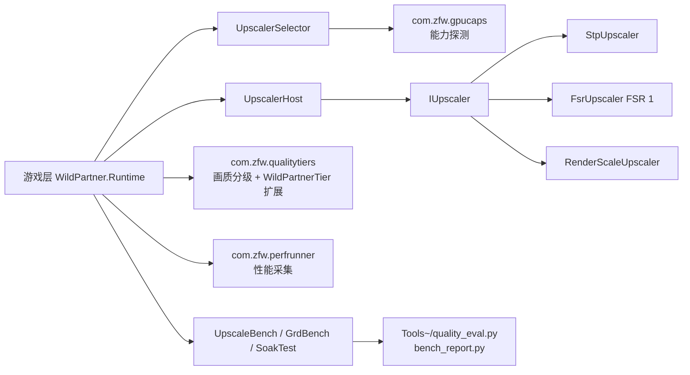

# 荒原伙伴（WildPartner）

一款 3D 探索收集游戏：小女巫在山谷里寻找五种伙伴（猫、月影兔、白色神鹿、月影蝶、赤墨锦鲤），有昼夜、天气、钓鱼、游泳、攀爬和骑鹿。技术重点是一套可复用的 **Unity URP 超分中间件**，配有自动评估管线。

Unity 6000.3.28f1 · URP 17（Forward+）· 开发和测试机：Apple M5 Max（Metal）。

## 下载
- **试玩（直接下载）**：[Windows 64 位](https://github.com/zhufengwang1997-lab/WildPartner/releases/download/v0.1.0/WildPartner-Windows-x64.zip) · [macOS](https://github.com/zhufengwang1997-lab/WildPartner/releases/download/v0.1.0/WildPartner-Mac.zip) · [发布页与说明](https://github.com/zhufengwang1997-lab/WildPartner/releases/tag/v0.1.0)
  - Windows：解压后双击 `WildPartner/WildPartner.exe`（SmartScreen 提示时点"更多信息 → 仍要运行"）。
  - macOS：解压后右键 `WildPartner.app` → 打开（未签名）。
- **源码**：`git clone https://github.com/zhufengwang1997-lab/WildPartner.git` 后执行 `git lfs pull`（或 [下载源码 zip](https://github.com/zhufengwang1997-lab/WildPartner/archive/refs/tags/v0.1.0.zip)，不含 LFS 大文件）。

## 如何运行
- **从源码**：用 Unity Hub 打开本仓库（Unity 6000.3.28f1），打开 `Assets/_Game/Scenes/World.unity` 运行。
- **打 Mac 包**：`tools/unity.sh WildPartner.EditorTools.BuildScript.BuildMac` → `Builds/Mac/WildPartner.app`。
- **打 Windows 包**（在 Mac 上交叉编译，Mono + DX12）：`tools/unity.sh WildPartner.EditorTools.BuildScript.BuildWindows`。
- 大文件（截图、模型）用 Git LFS，克隆后执行 `git lfs pull`。

## 操作
| 按键 | 作用 |
|---|---|
| WASD / 方向键 | 移动；鼠标转视角 |
| Shift | 奔跑 |
| 空格 | 跳跃 |
| Ctrl 或 C | 潜行（动物不容易发现你） |
| E | 按情境：按住捕捉 / 骑鹿与下来 / 开门 / 睡觉 / 钓鱼 |
| J | 切换跟随的伙伴 |
| Tab | 图鉴 |
| M | 大地图 |
| Esc | 暂停、设置 |
| F3 | 渲染调试面板（超分方案与档位、抗锯齿、输入可视化、Draw Call 读数） |

代码里也接了手柄输入（未用真手柄实测）。

## 架构

- `Packages/com.zfw.upscaling`：超分中间件（接口、三个后端、选择器、运行时宿主、单元测试、接入规范 `Documentation~/超分技术接入规范.md`）。游戏层不引用任何厂商 SDK（有测试检查）。
- `com.zfw.gpucaps` / `qualitytiers` / `perfrunner`：项目二《矿坑余烬》里的包，按 Git 标签引用（见 `Packages/manifest.json`），没有复制代码。
- 游戏侧渲染代码：`Assets/_Game/Scripts/Rendering/`。

## 功能状态
完整表格见 [`docs/STATUS.md`](docs/STATUS.md)。状态只有三种：已验证（写明设备）/ 已实现未验证 / 仅设计。

| 模块 | 状态 |
|---|---|
| 统一超分接口 + STP / FSR 1 / 渲染缩放三个后端 + 选择器 | 已验证（M5 Max） |
| 输入准备 IN-01~08（运动向量含风动草、Reactive Mask、切镜头清历史等） | 已验证（M5 Max）；Reactive Mask 当前后端不消费 |
| 时间性抗锯齿（关 / TAA / STP）、画质分级扩展、特效开销实测 | 已验证（M5 Max） |
| UpscaleBench 自动评估（6 场景 × 15 配置，FLIP / SSIM / PSNR / 帧率） | 已验证（M5 Max） |
| TC-10 挂机（10 分钟） | 已验证（M5 Max） |
| GPU Resident Drawer | **未达成**：Mac 上打开后 GRD 绘制的物体不显示，默认关闭（[`docs/GRD评估报告.md`](docs/GRD评估报告.md)） |
| DLSS、MetalFX、FSR 2/3、光追阴影、VRS、GPU 崩溃诊断 | 仅设计：[FSR 2/3 与 DLSS / MetalFX 后端](docs/设计方案/FSR2-3与DLSS-MetalFX后端.md)、[光追阴影 / VRS / GPU 崩溃诊断](docs/设计方案/光追-VRS-CrashDiag.md) |

## 实测数据摘要
Apple M5 Max，Metal，2560×1440，画质档 High，2026-11-23。出处：[`docs/超分评估报告-mac-20261123.md`](docs/超分评估报告-mac-20261123.md)，原始数据 `bench_results/mac-20261123/`。

| 配置 | 渲染分辨率 | FLIP ↓ | FPS | 比对应原生 |
|---|---|---|---|---|
| 原生 STP | 2560×1440 | 0.107 | 120 | — |
| 原生 TAA | 2560×1440 | 0.115 | 127 | — |
| STP 质量档 | 1707×960 | 0.111 | 160 | +34%（对原生 STP） |
| FSR 1 质量档 | 1707×960 | 0.140 | 168 | +33%（对原生 TAA） |
| 渲染缩放质量档 | 1707×960 | 0.140 | 180 | +42%（对原生 TAA） |

- 说明书要求质量档帧率提升 ≥ 40%：只有渲染缩放达标，STP 和 FSR 1 未达标（这台机器上游戏接近 CPU 瓶颈）。
- STP 在 6 个测试场景中画质都优于 FSR 1 和渲染缩放；关掉物体运动向量后，跑动场景 FLIP 变差 26%。
- FLIP 噪声底（同一参考配置拍两次）为 0.074；FPS 由关垂直同步后的实际帧时间算出。
- 挂机 10 分钟（1920×1080）：118.0 → 117.9 FPS，内存 171 → 171 MB（[`docs/挂机测试-mac-20261123.md`](docs/挂机测试-mac-20261123.md)）。
- 特效开销（1920×1080）：SSAO 1.3–3.8 ms、草地 0.7–1.4 ms 最贵（[`docs/特效开销清单.md`](docs/特效开销清单.md)，GPU 时间在 Metal 上只能看相对值）。

一条命令重跑评估：`tools/bench.sh <标签>`；挂机：`tools/soak.sh 600 <标签>`；GRD 对比：`tools/grd.sh <标签>`；冒烟测试：`tools/smoke.sh`。

## 文档
- 讲解稿：[`docs/讲解稿/`](docs/讲解稿/)（00 三分钟总览，01~07 各模块）
- 演示流程：[`docs/演示流程.md`](docs/演示流程.md)
- 进度与决策：[`docs/PROGRESS.md`](docs/PROGRESS.md)、[`docs/DECISIONS.md`](docs/DECISIONS.md)
- 第三方素材许可：[`docs/CREDITS.md`](docs/CREDITS.md)

## AI 辅助开发说明
本项目使用了 AI 辅助开发：
- **Claude Code**（Anthropic）：编写了大部分代码、工具脚本和文档，并运行构建、冒烟测试和评估。
- **Tripo**：生成 3D 模型（只用生成，不用它的绑定和动画功能）；骨骼和动作在 Blender 里制作。

所有性能和画质数字都来自仓库里真实运行生成的文件（CSV、截图、日志），并写明了设备、分辨率和日期。
