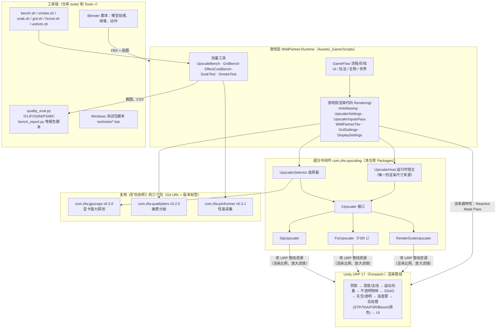

# 《荒原伙伴》01 · 架构全景

> **更新时间：2026-11-24 10:20（悉尼）**，对应代码版本 **v1.0.0（提交 a47a731，11-24 10:15 冻结）**。
> 本手册以这一版为准，覆盖了之前另一个会话写的版本（旧文件移到了 `旧版/`，那一版写于超分开工前，已过时）。
> 依据：仓库 `~/dev/WildPartner` 的代码和 `docs/`（DECISIONS、PROGRESS、STATUS、各评估报告）。
> 标记：✅ 已实现并验证（写明设备）｜🟡 已实现未验证｜📄 只写了设计文档｜❌ 做了但没达成｜❓ 待确认

---

## 1. 一句话说明

**一个 Unity 6.3（URP，Forward+）的 3D 探索收集小游戏，当作"试验田"，在上面做了一套可复用的"超分中间件"：游戏只跟一个统一接口打交道，背后按设备自动换成 STP / FSR 1 / 渲染缩放；再配一套自动评估工具，用数字回答"省了多少帧、丢了多少画质"。**

### 它要解决什么问题（大白话）

- **超分是什么**：先用较低的分辨率画画面（比如 1707×960），再"放大"到屏幕分辨率（2560×1440）。画的像素少了，显卡就轻松了，帧率就高了。
  - 类比：打印海报时，不画一张 2 米的原图，而是画一张 1.3 米的，再用聪明的方法放大到 2 米，看起来差不多但省了一半颜料。
- **难点**：放大的方法有很多家（NVIDIA 的 DLSS、AMD 的 FSR、苹果的 MetalFX、Unity 自带的 STP），每家的接口、要的输入、能跑的硬件都不一样。如果游戏里到处写"如果是 NVIDIA 就……如果是苹果就……"，代码会乱成一团。
- **这个项目的做法**：
  1. 定一个统一接口 `IUpscaler`（类比：统一的"电源插座"），每家方案做成一个"插头"（后端）。
  2. 一个"选择器"根据显卡能力自动挑最合适的插头。
  3. 游戏只负责把"放大需要的材料"准备好（运动向量、深度、抖动等，见 03），不关心具体是哪一家。
  4. 一套评估工具（UpscaleBench）自动在 6 个固定场景 × 15 种配置下截图、算画质误差和帧率，出报告。
- **为什么要一个游戏**：中间件必须在真实画面里检验——草在风里动、角色跑、粒子雨、镜头切换，这些正是超分最容易出问题（残影、闪烁）的地方。

---

## 2. 总架构图

### 怎么读这张图

| 层 | 是什么 | 生活类比 |
|---|---|---|
| 游戏层 | 玩法、UI、世界、生物，以及"游戏侧的渲染胶水代码" | 餐厅的前厅和服务员 |
| 超分中间件 | 统一接口 + 选择器 + 宿主 + 三个后端 | 厨房里的"统一点菜系统"，不管今天哪个厨师当班，服务员都用同一张单子 |
| 复用的三个包 | 能力探测、画质分级、性能采集，来自另一个项目《矿坑余烬》 | 连锁店总部发的标准设备，各分店直接用 |
| URP 管线 | Unity 自带的渲染流程，按固定顺序画一帧 | 厨房的流水线 |
| 工具链 | 自动测试、评估、出报告、模型处理的脚本 | 质检部门 |

### 关键数据流（按顺序）

1. **启动**：`Bootstrap` 读画质档位 → 应用抗锯齿 → `UpscalerSettings.Init()` 调**选择器**：用 GpuCaps 的能力报告，按 DLSS → MetalFX → STP → FSR1 → 渲染缩放 的顺序挑第一个"本机支持且这次打包里有"的后端（DLSS / MetalFX 这一版没有实现，所以实际从 STP 开始）。
2. **宿主初始化**：`UpscalerHost.Use(后端, 档位)` → 后端的 `Initialize(屏幕尺寸, 档位)` 返回**渲染尺寸**（比如 2560×1440 质量档 → 1707×960）。这是全项目**唯一**的渲染尺寸来源。
3. **写进管线**：内置后端把渲染尺寸换算成 URP 的 `renderScale`（渲染比例）和放大滤镜（STP / FSR / 线性），写进 URP 管线资源。URP 按这个比例渲染，最后自己执行放大。
4. **每帧**：
   - 游戏侧的 `UpscalerInputsPass` 画 Reactive Mask（标出粒子这类"没有可靠运动向量"的像素）。
   - 窗口尺寸变了 → 宿主自动重新 `Initialize`（TC-03）。
   - 镜头切换（进出木屋、传送、改显示模式）→ `AntiAliasing.ResetHistory()` 清历史帧（IN-08）。
5. **测量**：评估工具把截图交给 Python 的 `quality_eval.py` 算 FLIP / SSIM / PSNR，`bench_report.py` 出 Markdown 报告；PerfRunner 记录每帧耗时到 CSV。

---

## 3. 一帧画面从开始到显示在屏幕上

> 以默认设置为例：Mac M5 Max，2560×1440，STP 质量档（内部渲染 1707×960）。
> 注：后处理阶段里"STP 放大"和"FSR 放大"的确切位置以 URP 17 源码为准，下面是按 URP 17 的设计描述的。❓ 具体 Pass 顺序可以用 Unity 的 Frame Debugger 现场确认。

| 顺序 | 阶段 | 发生了什么 | 类比 |
|---|---|---|---|
| 1 | **输入** | Unity Input System 读键盘/鼠标/手柄，汇总到 `GameInput`（测试时也可以由脚本模拟输入）。F1 由 `DisplaySettings` 直接读。 | 顾客点菜 |
| 2 | **游戏逻辑（Update）** | 玩家移动和攀爬、生物 AI（逃跑、吃草、跟随）、昼夜和天气（`EnvController`、`Weather`）、风动时钟、钓鱼、捕捉。 | 服务员记下单子、安排上菜顺序 |
| 3 | **镜头（LateUpdate）** | Cinemachine 根据角色位置算出摄像机位置；爬树时 `CanopyCameraAvoid` 把镜头拉到树冠前。 | 摄影师站好位 |
| 4 | **提交绘制** | CPU 决定这一帧要画什么：视锥剔除（看不见的不画）、LOD（远处用简化模型）；草地由 `GrassRenderer` 按 7 m 一块提交 GPU 实例化绘制。 | 把菜谱发给厨房 |
| 5 | **阴影** | 主光（太阳/月亮）画阴影贴图。 | 先算好哪里有影子 |
| 6 | **深度 / 法线预通道** | 先画一遍"每个像素离镜头多远、朝哪个方向"，给 SSAO 和后面的 Pass 用。 | 先画草稿线 |
| 7 | **运动向量** | 记录每个像素"上一帧在哪里"。自写 Toon 着色器带专门的 MotionVectors Pass，**连风吹动的树和草也算进去**。超分/TAA 靠它把多帧对齐。 | 给每个像素贴一张"我从哪里来"的小纸条 |
| 8 | **不透明物体（Forward+）** | 用自写 Toon 着色器画角色、树、石头、木屋；地形用 ToonTerrain，草用 Grass 着色器。Forward+ 把屏幕分成小格子，每格只算影响它的那几盏灯。 | 正式上色 |
| 9 | **SSAO** | 屏幕空间环境光遮蔽：在物体贴地、角落处加一层柔和的暗影，让东西"坐"在地上。 | 给画加阴影过渡 |
| 10 | **天空 / 远山 / 透明物体** | 天空着色器（云也画在里面）、远山层、水面（反射探针）、粒子（雨、瀑布水雾、蝴蝶星尘）。 | 画背景和玻璃 |
| 11 | **高度雾** | 全屏 Pass，按高度和距离加雾，营造远近层次。 | 加一层薄雾滤镜 |
| 12 | **Reactive Mask** | 游戏自己的渲染器特性：把注册过的粒子画进一张遮罩图，告诉超分"这些像素别太相信历史帧"。（当前三个后端都**不读**这张图，是给将来 FSR 2/3、DLSS 准备的。） | 在单子上标出"这几道菜容易变形，别照旧做" |
| 13 | **抗锯齿 / 超分** | STP：结合当前帧、历史帧和运动向量，把 1707×960 的画面重建成 2560×1440，同时去锯齿。（如果选 FSR 1：先按渲染分辨率做完后处理，最后用 EASU 放大 + RCAS 锐化；选渲染缩放：线性放大。） | 把小幅画作精修放大成海报 |
| 14 | **后处理** | Bloom（灯光泛光）、调色（分离色调：暗部蓝紫、亮部暖色）、白平衡等。 | 修图滤镜 |
| 15 | **UI** | 屏幕空间覆盖画布，**按屏幕原始分辨率**单独画，不经过超分，所以文字永远清晰（IN-07）。11-24 起画布按 Expand 方式缩放，任何屏幕比例都完整显示。 | 最后贴上菜单标签 |
| 16 | **显示** | 交给 Metal（Mac）或 DX12（Windows）提交到屏幕。 | 端上桌 |

---

## 4. 3 分钟口述稿

> 用法：先背结构（问题 → 架构 → 关键设计 → 数据 → 不足），再用自己的话说。括号里是可以停下来展开的点。

**（问题，30 秒）**
"这个项目叫《荒原伙伴》，是一个用 Unity 6.3 URP 做的 3D 探索收集游戏，但游戏本身是载体。我真正要解决的问题是：超分方案很多——DLSS、FSR、MetalFX、Unity 自带的 STP——每家接口和要求都不一样，如果直接写进游戏，代码会被厂商细节绑死，换平台就要大改。"

**（架构，60 秒）**
"所以我做了三层。最上面是游戏层，只跟一个统一接口 `IUpscaler` 说话；中间是超分中间件，单独一个包，里面有接口、选择器、运行时宿主和三个后端：STP、FSR 1、渲染缩放；最下面是 URP 管线。选择器按 DLSS → MetalFX → STP → FSR → 渲染缩放 的优先级，用我在上一个项目里写的 GpuCaps 能力探测包判断本机支持什么。有一条硬规则：后端 `Initialize` 返回的渲染尺寸是全项目唯一的尺寸来源，冒烟测试会核对 URP 实际渲染宽度和它一致。另外两个复用包——画质分级和性能采集——也是按 Git 标签引用的，没有复制代码。"

**（游戏侧的输入准备，40 秒）**
"超分要好看，输入必须准。我自写的 Toon 着色器带运动向量 Pass，连风吹动的树和草都算了真实位移；粒子这类没有可靠运动的东西会画进 Reactive Mask；进出木屋、传送、切显示模式都会清历史帧，避免残影。"

**（数据，30 秒）**
"评估是自动的：6 个固定场景 × 15 种配置，和 2 倍超采样的参考图比，算 FLIP、SSIM、PSNR 和帧率。M5 Max 2560×1440 上，STP 质量档 FLIP 0.111，比 FSR 1 和渲染缩放的 0.140 好，6 个场景都赢；帧率提升 +34%，没达到说明书要求的 +40%，因为这台机器上游戏接近 CPU 瓶颈。我把这个结论如实写进了报告。"

**（不足和下一步，20 秒）**
"GPU Resident Drawer 在 Mac 上打开后物体不显示，最小场景都能复现，根因没找到，所以默认关闭；在 Windows DX12 上手动试过是正常的。DLSS、MetalFX、FSR 2/3 只写了设计文档，接口已经为它们留好了位置。"

---

## 5. 速查：项目里的数字（出处见 06）

| 项 | 数 |
|---|---|
| 地图 | 360 m × 360 m（`WorldLayout.Size`） |
| 植被实例 | 约 3.2 万个（树、灌木、石头等摆放表，运行时实例化） |
| 代码量 | 游戏脚本 + 超分包运行时 C# 约 1.2 万行（`wc -l`，含注释） |
| 超分档位 | 质量 67%、平衡约 59%、性能 50%（每个方向的比例） |
| 冒烟测试 | 93 个检查步骤，打包后的游戏里自动跑完整流程（a47a731 全部通过） |
| 版本 | v1.0.0 = 提交 a47a731，Release：github.com/zhufengwang1997-lab/WildPartner/releases/latest |
